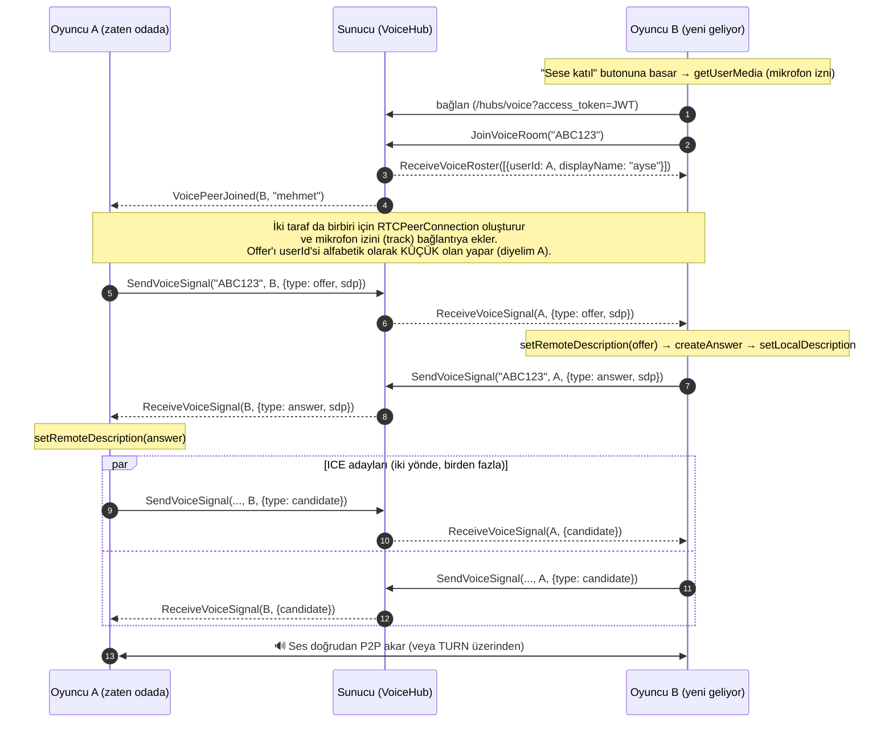
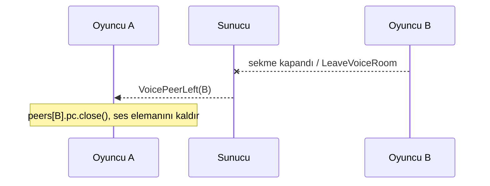

# Sesli Sohbet Rehberi — YouTubeParty'deki yapı ve Kanlı Okey'e taşınması

Bu doküman iki şey anlatır:

1. **YouTubeParty'de sesli sohbetin nasıl çalıştığı** (sunucu kodu satır satır, protokol, akış).
2. **Aynı mantığın Kanlı Okey'e nasıl ekleneceği** (backend `VoiceHub`, React/TypeScript istemci, STUN/TURN, test listesi).

> **Önemli not:** YouTubeParty reposunda sadece **sunucu** (ASP.NET Core) kodu var. Sesli sohbetin tarayıcı tarafı
> (WebRTC kodu, muhtemelen tarayıcı eklentisinde) bu repoda ve bu bilgisayarda bulunamadı. Bu yüzden istemci tarafı
> aşağıda sunucunun protokolünden (metot/olay adları ve parametreleri) çıkarılarak yazıldı. Eklentinin kaynak kodu
> elinizdeyse Bölüm 7'deki istemciyle karşılaştırın; protokol birebir aynıdır.

---

## İçindekiler

1. [Kısa özet: Sistem nasıl çalışıyor?](#1-kısa-özet-sistem-nasıl-çalışıyor)
2. [Temel kavramlar (WebRTC, sinyalleşme, SDP, ICE, STUN/TURN)](#2-temel-kavramlar)
3. [YouTubeParty sunucu tarafı — detaylı inceleme](#3-youtubeparty-sunucu-tarafı--detaylı-inceleme)
4. [Protokol sözleşmesi (metotlar, olaylar, payload)](#4-protokol-sözleşmesi)
5. [Uçtan uca akış (adım adım)](#5-uçtan-uca-akış)
6. [Orijinal koddaki zayıf noktalar ve okey sürümünde düzeltilmesi](#6-orijinal-koddaki-zayıf-noktalar)
7. [Kanlı Okey'e ekleme — Backend](#7-kanlı-okeye-ekleme--backend)
8. [Kanlı Okey'e ekleme — Frontend (React + TypeScript)](#8-kanlı-okeye-ekleme--frontend-react--typescript)
9. [STUN / TURN sunucusu (production için şart)](#9-stun--turn-sunucusu)
10. [Tarayıcı kuralları: HTTPS, mikrofon izni, autoplay, mobil](#10-tarayıcı-kuralları)
11. [Test listesi](#11-test-listesi)
12. [Sorun giderme](#12-sorun-giderme)

---

## 1. Kısa özet: Sistem nasıl çalışıyor?

YouTubeParty'deki sesli sohbet **WebRTC mesh (eşler arası, P2P)** mimarisidir:

- **Ses sunucudan geçmez.** Her oyuncu, odadaki diğer her oyuncuyla **doğrudan** bir `RTCPeerConnection` kurar
  ve sesi tarayıcıdan tarayıcıya gönderir.
- **Sunucunun tek görevi "sinyalleşme"dir (signaling):** iki tarayıcının birbirini bulup bağlantı kurabilmesi için
  gereken küçük mesajları (SDP offer/answer ve ICE adayları) **SignalR üzerinden** birinden alıp diğerine iletir.
  Sunucu bu mesajların içeriğini **okumaz, yorumlamaz**; sadece "şu kullanıcıdan şu kullanıcıya" postacılık yapar.
- Sesli sohbet, video senkronizasyonundan **ayrı bir hub**'dadır: `VoiceSignalingHub` → `/voicehub`.
  Video/sohbet hub'ı (`WatchPartyHub` → `/watchpartyhub`) ile aynı `roomId` değerini kullanır ama ayrı bir SignalR
  bağlantısıdır.
- Kimlik **JWT** ile doğrulanır (`[Authorize]`). Kullanıcı kimliği her zaman token'dan okunur, istemcinin gönderdiği
  bir isme/ID'ye güvenilmez.

```
                 ┌──────────────────────────────┐
                 │   Sunucu (SignalR VoiceHub)  │   ← sadece küçük metin mesajları
                 │   "postacı": offer/answer/ICE│      (birkaç KB)
                 └───▲──────────▲──────────▲────┘
                     │          │          │
             SignalR │  SignalR │  SignalR │
                     │          │          │
               ┌─────┴──┐  ┌────┴───┐  ┌───┴────┐
               │Oyuncu A│◄─►Oyuncu B│◄─►Oyuncu C│   ← ses: doğrudan P2P (WebRTC/SRTP)
               └────▲───┘  └────────┘  └───▲────┘
                    └──────────────────────┘
```

4 kişilik okey masası için: her oyuncu 3 bağlantı açar, masada toplam 6 P2P bağlantı olur. Opus ses kodeği ile
oyuncu başına yaklaşık 3 × 30–50 kbps yükleme gerekir; bu her ev/mobil internet için rahattır. Mesh mimarisi
~6 kişiye kadar sorunsuzdur; 4 kişilik okey için idealdir (ayrıca medya sunucusu/SFU gerekmez).

---

## 2. Temel kavramlar

| Kavram | Ne işe yarar? |
|---|---|
| **WebRTC** | Tarayıcıların ses/görüntüyü doğrudan birbirine göndermesini sağlayan standart API. Ses şifreli (DTLS-SRTP) gider. |
| **`getUserMedia`** | Mikrofonu açar, bir `MediaStream` (ses izi/track) döner. Kullanıcıdan izin ister. |
| **`RTCPeerConnection`** | İki tarayıcı arasındaki tek bir bağlantı. 4 kişilik masada her oyuncuda 3 tane olur. |
| **Sinyalleşme (signaling)** | Bağlantı kurulmadan önce iki tarafın birbirine bilgi göndermesi. WebRTC bunu kendisi yapmaz; biz SignalR ile yapıyoruz. |
| **SDP offer / answer** | "Ben şu kodekleri destekliyorum, şu medyayı göndereceğim" bilgisi. Bir taraf **offer** (teklif) üretir, diğeri **answer** (cevap) döner. |
| **ICE candidate** | "Bana şu IP:port üzerinden ulaşabilirsin" adayları. Her iki taraf da birden fazla aday üretip karşıya gönderir; çalışan ilk yol seçilir. |
| **STUN** | Tarayıcının kendi **dış (public) IP**'sini öğrenmesini sağlayan ücretsiz/hafif sunucu. Çoğu bağlantı bununla kurulur. |
| **TURN** | Doğrudan bağlantı **kurulamadığında** (simetrik NAT, kurumsal ağ, bazı mobil operatörler) sesi **aktaran** sunucu. Production'da şarttır (Bölüm 9). |

---

## 3. YouTubeParty sunucu tarafı — detaylı inceleme

İlgili dosyalar:

| Dosya | Sesli sohbetteki rolü |
|---|---|
| [YouTubeParty/Hubs/VoiceSignalingHub.cs](YouTubeParty/Hubs/VoiceSignalingHub.cs) | Sinyalleşme hub'ı (asıl kod) |
| [YouTubeParty/Hubs/RoomParticipant.cs](YouTubeParty/Hubs/RoomParticipant.cs) | `record RoomParticipant(string UserId, string DisplayName)` — katılımcı listesi elemanı |
| [YouTubeParty/Program.cs](YouTubeParty/Program.cs) | SignalR, JWT (query string token), CORS, `MapHub<VoiceSignalingHub>("/voicehub")` |
| [YouTubeParty/Controllers/UsersController.cs](YouTubeParty/Controllers/UsersController.cs) | Görünen ad değişince ses odasına `VoicePeerDisplayNameChanged` yayını |
| [YouTubeParty/Services/TokenService.cs](YouTubeParty/Services/TokenService.cs) | JWT üretimi (`NameIdentifier` claim'i = kullanıcı ID'si) |

### 3.1 `Program.cs` — altyapı

1. **SignalR kaydı** ([Program.cs:16](YouTubeParty/Program.cs#L16)): `builder.Services.AddSignalR();`
2. **JWT'nin query string'den okunması** ([Program.cs:65-77](YouTubeParty/Program.cs#L65-L77)):
   Tarayıcılar WebSocket açarken `Authorization` header'ı gönderemez. SignalR istemcisi bu yüzden token'ı
   `?access_token=...` olarak ekler. Sunucu, **sadece hub yollarında** (`/watchpartyhub`, `/voicehub`) bu parametreyi
   token olarak kabul eder:
   ```csharp
   OnMessageReceived = context =>
   {
       var accessToken = context.Request.Query["access_token"];
       var path = context.HttpContext.Request.Path;
       if (!string.IsNullOrEmpty(accessToken) &&
           (path.StartsWithSegments("/watchpartyhub") || path.StartsWithSegments("/voicehub")))
       {
           context.Token = accessToken;
       }
       return Task.CompletedTask;
   }
   ```
3. **CORS** ([Program.cs:93](YouTubeParty/Program.cs#L93)): `AllowCredentials()` SignalR için zorunludur.
4. **Sıralama**: `UseCors` → `UseAuthentication` → `UseAuthorization` → `MapHub`.
5. **Hub adresi** ([Program.cs:121](YouTubeParty/Program.cs#L121)): `app.MapHub<VoiceSignalingHub>("/voicehub");`

### 3.2 `VoiceSignalingHub` — durum (state)

```csharp
private static readonly ConcurrentDictionary<string, (string RoomId, string UserId, string DisplayName)> Peers = new();
```
([VoiceSignalingHub.cs:16](YouTubeParty/Hubs/VoiceSignalingHub.cs#L16))

- **Anahtar:** SignalR `ConnectionId` (her tarayıcı sekmesinin her bağlantısı için ayrı).
- **Değer:** hangi ses odasında olduğu, kullanıcı ID'si, görünen adı.
- `static` olduğu için **RAM'de** ve **tek sunucu** varsayımıyla çalışır (birden fazla sunucuya ölçeklemek için
  Redis backplane + paylaşılan state gerekir).
- Hub sınıfının kendisi her çağrıda yeniden oluşturulur; kalıcı olması gereken her şey bu static sözlükte durur.

**Kimlik çözümleme** ([VoiceSignalingHub.cs:24-48](YouTubeParty/Hubs/VoiceSignalingHub.cs#L24-L48)):

- `ResolveUserId()`: token'daki `ClaimTypes.NameIdentifier` claim'i (yoksa `ConnectionId`).
- `ResolveIdentityForJoinAsync()`: **sadece katılırken bir kez** DB'den kullanıcıyı okur ve görünen adı bulur.
- `GetCachedIdentity()`: sonraki çağrılarda DB'ye gitmeden `Peers` sözlüğünden okur (hızlı).

### 3.3 `JoinVoiceRoom(roomId)` — ses odasına katılma

([VoiceSignalingHub.cs:50-66](YouTubeParty/Hubs/VoiceSignalingHub.cs#L50-L66))

```csharp
public async Task JoinVoiceRoom(string roomId)
{
    var (userId, displayName) = await ResolveIdentityForJoinAsync();

    await Groups.AddToGroupAsync(Context.ConnectionId, roomId);            // 1

    var existingParticipants = Peers.Values                                // 2
        .Where(p => p.RoomId == roomId)
        .Select(p => new RoomParticipant(p.UserId, p.DisplayName))
        .Distinct()
        .ToList();

    Peers[Context.ConnectionId] = (roomId, userId, displayName);           // 3

    await Clients.Caller.SendAsync("ReceiveVoiceRoster", existingParticipants);        // 4
    await Clients.OthersInGroup(roomId).SendAsync("VoicePeerJoined", userId, displayName); // 5
}
```

1. Bağlantı, SignalR grubuna (`roomId`) eklenir → odaya yapılan yayınları alır.
2. **Kendisi eklenmeden önce** odadaki mevcut kişilerin listesi çıkarılır (yani liste kendisini içermez).
3. Kendisi `Peers`'e eklenir.
4. **Yeni gelene**: "odada şu an bunlar var" → `ReceiveVoiceRoster(liste)`.
5. **Odadaki diğerlerine**: "yeni biri geldi" → `VoicePeerJoined(userId, displayName)`.

Bu iki mesajdan sonra her iki taraf da birbirinden haberdardır ve WebRTC bağlantısını kurmaya başlar.

### 3.4 `SendVoiceSignal(roomId, targetUserId, payload)` — postacı

([VoiceSignalingHub.cs:68-81](YouTubeParty/Hubs/VoiceSignalingHub.cs#L68-L81))

```csharp
public async Task SendVoiceSignal(string roomId, string targetUserId, string payload)
{
    var (userId, _) = GetCachedIdentity();

    var targetConnectionId = Peers
        .Where(kvp => kvp.Value.RoomId == roomId && kvp.Value.UserId == targetUserId)
        .Select(kvp => kvp.Key)
        .FirstOrDefault();

    if (targetConnectionId != null)
    {
        await Clients.Client(targetConnectionId).SendAsync("ReceiveVoiceSignal", userId, payload);
    }
}
```

- `payload` **opak bir string**'dir. Sunucu içine bakmaz. İstemci içine JSON olarak offer / answer / ICE adayı koyar.
- Hedef kullanıcının bağlantısı bulunur ve mesaj **sadece ona** `ReceiveVoiceSignal(gönderenUserId, payload)` olarak iletilir.
- **Gönderen kimliği sunucu tarafından eklenir** (token'dan), istemci "ben şuyum" diyemez → sahtecilik engellenir.

### 3.5 `LeaveVoiceRoom(roomId)` ve `OnDisconnectedAsync`

([VoiceSignalingHub.cs:83-99](YouTubeParty/Hubs/VoiceSignalingHub.cs#L83-L99))

- Bilinçli ayrılma (`LeaveVoiceRoom`) veya bağlantı kopması (`OnDisconnectedAsync`, sekme kapandı / internet gitti):
  - `Peers`'ten silinir, gruptan çıkarılır.
  - Odadaki diğerlerine `VoicePeerLeft(userId)` gider → onlar o kişiyle olan `RTCPeerConnection`'ı kapatır.

### 3.6 Görünen ad değişikliği

[VoiceSignalingHub.cs:102](YouTubeParty/Hubs/VoiceSignalingHub.cs#L102) `UpdateDisplayNameForUser` static metodu,
[UsersController.cs:61](YouTubeParty/Controllers/UsersController.cs#L61) tarafından çağrılır: kullanıcı adını
değiştirince `Peers` önbelleği güncellenir ve ses odasına `VoicePeerDisplayNameChanged(userId, yeniAd)` yayınlanır.
Hub dışından yayın `IHubContext<VoiceSignalingHub>` ile yapılır. (Kanlı Okey'de görünen ad değiştirme olmadığı için
bu kısım taşınmaz.)

---

## 4. Protokol sözleşmesi

### 4.1 İstemci → Sunucu (`connection.invoke`)

| Metot | Parametreler | Ne yapar |
|---|---|---|
| `JoinVoiceRoom` | `roomId: string` | Ses odasına katılır. Cevap olarak kendisine `ReceiveVoiceRoster`, diğerlerine `VoicePeerJoined` gider. |
| `SendVoiceSignal` | `roomId: string, targetUserId: string, payload: string` | `payload`'ı hedef kullanıcıya iletir. |
| `LeaveVoiceRoom` | `roomId: string` | Ses odasından ayrılır. Diğerlerine `VoicePeerLeft` gider. |

### 4.2 Sunucu → İstemci (`connection.on`)

| Olay | Parametreler | Ne zaman gelir / istemci ne yapmalı |
|---|---|---|
| `ReceiveVoiceRoster` | `participants: { userId, displayName }[]` | Katılınca, odada **zaten olan** kişiler. Her biri için bir `RTCPeerConnection` hazırla. |
| `VoicePeerJoined` | `userId: string, displayName: string` | Odaya yeni biri katıldı. Onun için bir `RTCPeerConnection` hazırla. |
| `ReceiveVoiceSignal` | `fromUserId: string, payload: string` | Birinden offer/answer/ICE geldi. İlgili `RTCPeerConnection`'a uygula. |
| `VoicePeerLeft` | `userId: string` | Biri ayrıldı/koptu. O kişinin bağlantısını kapat, ses elemanını kaldır. |
| `VoicePeerDisplayNameChanged` | `userId: string, displayName: string` | (Sadece YouTubeParty) Ad değişti, arayüzü güncelle. |

> JSON varsayılan olarak **camelCase**'tir: C#'taki `RoomParticipant(UserId, DisplayName)` istemciye
> `{ "userId": "...", "displayName": "..." }` olarak gelir.

### 4.3 `payload` formatı

Sunucu için `payload` sadece bir string'dir. İstemcide şu JSON şeması kullanılır (Bölüm 8'deki kodla aynı):

```jsonc
{ "type": "offer",     "sdp": "v=0\r\no=- 4611... (SDP metni)" }
{ "type": "answer",    "sdp": "v=0\r\no=- 8273... (SDP metni)" }
{ "type": "candidate", "candidate": { "candidate": "candidate:842163049 1 udp ...", "sdpMid": "0", "sdpMLineIndex": 0 } }
```

SDP birkaç KB'tır; SignalR'ın varsayılan mesaj sınırı (32 KB) yeterlidir.

---

## 5. Uçtan uca akış

### 5.1 Yeni oyuncunun katılması



### 5.2 Ayrılma / kopma



### 5.3 Offer'ı kim yapar? (önemli tasarım kararı)

Sunucu bunu belirlemez; istemcinin kararıdır. İki yaygın yol var:

- **"Yeni gelen offer yapar"**: `ReceiveVoiceRoster` gelince yeni gelen herkese offer gönderir, eskiler bekler.
  Basittir ama **iki kişi aynı anda katılırsa** (okeyde 4 oyuncu masaya hemen hemen aynı anda oturur!) ikisi de
  birbirini roster'da değil `VoicePeerJoined` ile görebilir → ikisi de "eski" rolüne geçer ve **kimse offer yapmaz**,
  bağlantı hiç kurulmaz.
- **Deterministik kural (önerilen, Bölüm 8'deki kod bunu kullanır):** Bir eşten (roster veya `VoicePeerJoined`
  ile) haberdar olunduğunda, **`benimUserId < onunUserId` ise offer'ı ben yaparım**, değilse beklerim. Her çift için
  her zaman tam olarak bir taraf offer yapar; katılma sırasından ve yarışlardan etkilenmez. Aynı kişi hem roster'da
  hem `VoicePeerJoined`'da gelirse ikinci bildirim yok sayılır (zaten bağlantı var).

---

## 6. Orijinal koddaki zayıf noktalar

YouTubeParty kodu çalışıyor ama bir oyuna (özellikle para/coin olan bir oyuna) taşırken şu noktalar düzeltilmeli.
Bölüm 7'deki okey sürümü bunların hepsini çözer; **protokol (metot ve olay adları, parametreler) aynı kalır.**

| # | Orijinal davranış | Risk | Okey sürümünde |
|---|---|---|---|
| 1 | `JoinVoiceRoom` oda üyeliğini kontrol etmez; token'ı olan herkes, kodunu bildiği herhangi bir odanın sesine katılabilir. | Yabancılar masadaki konuşmaları dinleyebilir. | Sadece o masada **oturan** oyuncu katılabilir (`IGameRoomManager` ile kontrol). |
| 2 | `SendVoiceSignal` ve `LeaveVoiceRoom` istemcinin gönderdiği `roomId`'ye güvenir. | Başka odadaki kullanıcıya sinyal gönderilebilir. | Oda her zaman sunucudaki kayıttan alınır; parametre sadece doğrulanır. |
| 3 | Aynı kullanıcı iki sekmeden katılırsa iki kayıt olur; hedef seçimi `FirstOrDefault` ile rastgele olur. Eski sekme kapanınca diğerlerine `VoicePeerLeft` gider, yeni sekmenin sesi de kesilir. | Sayfa yenileme / çift sekme ile ses kopuyor. | Kullanıcı başına tek kayıt; yeni bağlantı eskisinin yerine geçer, eski bağlantının kopması yenisini etkilemez. |
| 4 | Aynı bağlantı `LeaveVoiceRoom` çağırmadan başka odaya `JoinVoiceRoom` derse eski grupta kalır. | Eski odanın yayınlarını almaya devam eder. | Eski oda kaydı ve grubu temizlenir. |
| 5 | Roster oluşturma + ekleme kilitsiz. | Eşzamanlı katılımda tutarsız liste. | Basit bir `lock` (kilit içinde `await` yok, okey projesindeki desenle aynı). |
| 6 | `payload` boyutu sınırsız (32 KB SignalR sınırı hariç). | Kötüye kullanım. | 16 KB üst sınır. |
| 7 | Sunucuda TURN yapılandırması yok. | Bazı ağlarda (mobil/kurumsal) ses hiç kurulmaz. | Bölüm 9: coturn + kısa ömürlü kimlik bilgisi uç noktası. |

---

## 7. Kanlı Okey'e ekleme — Backend

Kanlı Okey'deki mevcut altyapı ile uyum:

- Hub'lar `/hubs` önekinde (`AuthenticationExtensions.HubsPathPrefix`). JWT'nin `access_token` query'den okunması
  **zaten tüm `/hubs/*` yolları için** yapılıyor → yeni hub'ı `/hubs/voice` yaparsanız **auth için ek bir şey
  gerekmez**. (YouTubeParty'de `/voicehub` yolunu `OnMessageReceived`'a ayrıca eklemek gerekmişti.)
- Kimlik: `Context.User!.GetUserId()` (Guid, `UserId` claim'i) ve `GetUsername()` (`Username` claim'i).
- Masa bilgisi RAM'de: `IGameRoomManager.GetRoomByUser(userId)`, `room.RoomId` (6 karakterlik kod),
  `lock (room.SyncRoot)` + `room.FindPlayer(userId)`.
- Kesin tipli hub (`Hub<IGameClient>`) kullanılıyor → ses için de `Hub<IVoiceClient>`.
- CORS `Cors:AllowedOrigins` ile zaten `AllowCredentials()` → değişiklik gerekmez.

### 7.1 Yeni dosya: `KanliOkey.API/Hubs/IVoiceClient.cs`

```csharp
namespace KanliOkey.API.Hubs;

/// <summary>Sesli sohbette katılımcı listesi elemanı. JSON: { userId, displayName }.</summary>
public record VoiceParticipant(string UserId, string DisplayName);

/// <summary>
/// Sesli sohbet hub'ının istemciye çağırdığı metodlar (istemci bu adlarla dinler: connection.on("VoicePeerJoined", ...)).
/// Adlar YouTubeParty'deki VoiceSignalingHub ile birebir aynıdır.
/// </summary>
public interface IVoiceClient
{
    /// <summary>Katılan oyuncuya: ses odasında zaten olan oyuncular (kendisi hariç).</summary>
    Task ReceiveVoiceRoster(List<VoiceParticipant> participants);

    /// <summary>Odadaki diğerlerine: yeni bir oyuncu sese katıldı.</summary>
    Task VoicePeerJoined(string userId, string displayName);

    /// <summary>Odadaki diğerlerine: bir oyuncu sesten ayrıldı veya bağlantısı koptu.</summary>
    Task VoicePeerLeft(string userId);

    /// <summary>Sadece hedef oyuncuya: WebRTC sinyali (offer / answer / ICE adayı). Sunucu içeriğe bakmaz.</summary>
    Task ReceiveVoiceSignal(string fromUserId, string payload);
}
```

### 7.2 Yeni dosya: `KanliOkey.API/Hubs/VoiceHub.cs`

```csharp
using KanliOkey.API.Extensions;
using KanliOkey.Core.Interfaces;
using Microsoft.AspNetCore.Authorization;
using Microsoft.AspNetCore.SignalR;

namespace KanliOkey.API.Hubs;

/// <summary>
/// Sesli sohbet için WebRTC sinyalleşme noktası (YouTubeParty VoiceSignalingHub ile aynı protokol).
/// Ses sunucudan geçmez: oyuncular birbirine doğrudan (P2P) bağlanır, bu hub sadece offer/answer/ICE
/// mesajlarını hedef oyuncuya iletir. Kimlik JWT'den okunur; sadece o masada oturan oyuncular katılabilir.
/// <para>
/// Durum RAM'de ve tek sunucu varsayımıyla tutulur (masalar gibi). Kilit içinde await yapılmaz.
/// </para>
/// </summary>
[Authorize]
public class VoiceHub(IGameRoomManager rooms) : Hub<IVoiceClient>
{
    /// <summary>SDP birkaç KB'tır; bundan büyük sinyal kabul edilmez.</summary>
    private const int MaxPayloadLength = 16 * 1024;

    private sealed record VoicePeer(string RoomId, string UserId, string DisplayName);

    // ConnectionId → ses odasındaki kayıt. Bir kullanıcının aynı anda tek kaydı olur (son bağlantı geçerli).
    private static readonly Dictionary<string, VoicePeer> Peers = [];
    private static readonly Lock Sync = new();

    /// <summary>
    /// Masanın ses odasına katılır. Katılana odadakilerin listesi (ReceiveVoiceRoster), diğerlerine
    /// VoicePeerJoined gider. Aynı kullanıcının eski bağlantısı (yenilenen sekme) varsa onun yerine geçer.
    /// </summary>
    public async Task JoinVoiceRoom(string roomId)
    {
        var userId = Context.User!.GetUserId();
        var code = roomId?.Trim().ToUpperInvariant() ?? string.Empty;

        if (!IsSeatedIn(userId, code))
            throw new HubException("Sesli sohbete sadece bu masada oturan oyuncular katılabilir.");

        var me = new VoicePeer(code, userId.ToString(), Context.User!.GetUsername());
        VoicePeer? previous;
        string? replacedConnectionId;
        List<VoiceParticipant> roster;

        lock (Sync)
        {
            // Bu bağlantı zaten bir ses odasındaysa (tekrar katılma / oda değiştirme) eski kaydı kaldır.
            Peers.Remove(Context.ConnectionId, out previous);

            // Aynı kullanıcının başka bir bağlantısı (eski sekme) varsa düşür: kullanıcı başına tek kayıt.
            replacedConnectionId = Peers.FirstOrDefault(p => p.Value.UserId == me.UserId).Key;
            if (replacedConnectionId is not null)
                Peers.Remove(replacedConnectionId, out _);

            roster = Peers.Values
                .Where(p => p.RoomId == code)
                .Select(p => new VoiceParticipant(p.UserId, p.DisplayName))
                .ToList();

            Peers[Context.ConnectionId] = me;
        }

        if (previous is not null)
        {
            await Groups.RemoveFromGroupAsync(Context.ConnectionId, previous.RoomId);
            await Clients.Group(previous.RoomId).VoicePeerLeft(me.UserId);
        }

        if (replacedConnectionId is not null)
        {
            // Diğerleri eski bağlantıyla kurdukları WebRTC bağlantısını kapatsın; yenisi az sonra Joined ile gelecek.
            await Groups.RemoveFromGroupAsync(replacedConnectionId, code);
            await Clients.Group(code).VoicePeerLeft(me.UserId);
        }

        await Groups.AddToGroupAsync(Context.ConnectionId, code);
        await Clients.Caller.ReceiveVoiceRoster(roster);
        await Clients.OthersInGroup(code).VoicePeerJoined(me.UserId, me.DisplayName);
    }

    /// <summary>
    /// WebRTC sinyalini (offer / answer / ICE adayı) aynı ses odasındaki hedef oyuncuya iletir.
    /// Gönderen kimliği sunucu tarafından eklenir; hedef başka odadaysa veya yoksa mesaj sessizce düşer.
    /// </summary>
    public async Task SendVoiceSignal(string roomId, string targetUserId, string payload)
    {
        if (string.IsNullOrEmpty(payload) || payload.Length > MaxPayloadLength)
            throw new HubException("Geçersiz ses sinyali.");

        VoicePeer? sender;
        string? targetConnectionId = null;

        lock (Sync)
        {
            if (Peers.TryGetValue(Context.ConnectionId, out sender))
            {
                targetConnectionId = Peers
                    .FirstOrDefault(p => p.Value.RoomId == sender.RoomId && p.Value.UserId == targetUserId)
                    .Key;
            }
        }

        // Oda her zaman sunucudaki kayıttan alınır; istemcinin gönderdiği roomId sadece doğrulanır.
        if (sender is null || targetConnectionId is null ||
            !string.Equals(sender.RoomId, roomId?.Trim(), StringComparison.OrdinalIgnoreCase))
            return;

        await Clients.Client(targetConnectionId).ReceiveVoiceSignal(sender.UserId, payload);
    }

    /// <summary>Ses odasından ayrılır; diğerlerine VoicePeerLeft gider. Parametre YouTubeParty ile uyum için var.</summary>
    public Task LeaveVoiceRoom(string roomId) => RemoveConnectionAsync();

    public override async Task OnDisconnectedAsync(Exception? exception)
    {
        // Sadece bu bağlantının kaydı silinir: yerine yeni sekme geçtiyse eski bağlantının kopması yenisini etkilemez.
        await RemoveConnectionAsync();
        await base.OnDisconnectedAsync(exception);
    }

    /// <summary>
    /// Oyuncu masadan kalktığında (GameHub.LeaveRoom, PlayerRemoved) ses odasından da çıkarılır.
    /// Hub dışından IHubContext ile çağrılır.
    /// </summary>
    public static async Task RemoveUserAsync(IHubContext<VoiceHub, IVoiceClient> hub, Guid userId)
    {
        var id = userId.ToString();
        List<KeyValuePair<string, VoicePeer>> removed;

        lock (Sync)
        {
            removed = Peers.Where(p => p.Value.UserId == id).ToList();
            foreach (var entry in removed)
                Peers.Remove(entry.Key);
        }

        foreach (var (connectionId, peer) in removed)
        {
            await hub.Groups.RemoveFromGroupAsync(connectionId, peer.RoomId);
            await hub.Clients.Group(peer.RoomId).VoicePeerLeft(peer.UserId);
        }
    }

    private async Task RemoveConnectionAsync()
    {
        VoicePeer? peer;
        lock (Sync)
        {
            Peers.Remove(Context.ConnectionId, out peer);
        }

        if (peer is null)
            return;

        await Groups.RemoveFromGroupAsync(Context.ConnectionId, peer.RoomId);
        await Clients.Group(peer.RoomId).VoicePeerLeft(peer.UserId);
    }

    private bool IsSeatedIn(Guid userId, string roomCode)
    {
        if (rooms.GetRoomByUser(userId) is not { } room || room.RoomId != roomCode)
            return false;

        lock (room.SyncRoot)
        {
            return room.FindPlayer(userId) is not null;
        }
    }
}
```

### 7.3 `Program.cs` değişikliği

```csharp
app.MapHub<GameHub>($"{AuthenticationExtensions.HubsPathPrefix}/game");
app.MapHub<VoiceHub>($"{AuthenticationExtensions.HubsPathPrefix}/voice");   // ← YENİ
```

Başka hiçbir yapılandırma gerekmez (SignalR, JWT, CORS zaten hazır).

### 7.4 (Önerilen) Masadan kalkan oyuncuyu sesten de çıkarmak

`GameHub`'a `IHubContext<VoiceHub, IVoiceClient> voiceHub` enjekte edin ve `LeaveRoom` içinde oyuncu masadan
gerçekten kaldırıldığında çağırın:

```csharp
public class GameHub(
    IGameRoomManager rooms,
    IGameRulesService rules,
    IWalletService wallet,
    GameEventPublisher publisher,
    IHubContext<VoiceHub, IVoiceClient> voiceHub,   // ← YENİ
    ILogger<GameHub> logger) : Hub<IGameClient>
{
    // ...
    public async Task LeaveRoom()
    {
        var leave = rooms.LeaveRoom(UserId)
            ?? throw new HubException("Bir masada oturmuyorsunuz.");

        await Groups.RemoveFromGroupAsync(Context.ConnectionId, leave.RoomId);
        await BroadcastRoomAsync(leave.RoomId);

        if (leave.PlayerRemoved)
            await VoiceHub.RemoveUserAsync(voiceHub, UserId);   // ← YENİ
        else
            await Clients.Caller.Notice("Oyun sürüyor: koltuğunuz korunuyor, Rejoin ile geri dönebilirsiniz.");
    }
}
```

Aynısı bakiyesi yetmediği için masadan çıkarılan oyuncular (`StartGameAsync` içindeki `rooms.LeaveRoom(userId)`
döngüsü) için de yapılabilir. Not: Zaten kurulmuş bir P2P ses bağlantısını sunucu fiziksel olarak kesemez; diğer
oyuncuların istemcileri `VoicePeerLeft` alınca bağlantıyı kapatır. Bu yüzden istemcinin `VoicePeerLeft`'i doğru
işlemesi gerekir (Bölüm 8 kodu yapıyor).

### 7.5 (Önerilen) Entegrasyon testi fikirleri

Mevcut `KanliOkey.IntegrationTests` altyapısıyla (`WebApplicationFactory` + SignalR istemcisi):

1. Masada olmayan kullanıcı `JoinVoiceRoom` → `HubException`.
2. A ve B aynı masada: B katılınca B `ReceiveVoiceRoster([A])`, A `VoicePeerJoined(B)` alır.
3. A → B `SendVoiceSignal` → B `ReceiveVoiceSignal(A, aynıPayload)` alır; C (başka masa) hiçbir şey almaz.
4. B'nin bağlantısı kapanınca A `VoicePeerLeft(B)` alır.
5. B ikinci bağlantıyla tekrar katılır → A önce `VoicePeerLeft(B)` sonra `VoicePeerJoined(B)` alır; eski bağlantı
   kapanınca A **ikinci bir** `VoicePeerLeft` **almaz**.

---

## 8. Kanlı Okey'e ekleme — Frontend (React + TypeScript)

Okey frontend'i React 19 + Vite + `@microsoft/signalr` kullanıyor. Ses için **ayrı bir hub bağlantısı** açılır
(oyun bağlantısına dokunulmaz).

### 8.1 `src/voice/voiceChat.ts` — framework'ten bağımsız sesli sohbet sınıfı

```ts
import * as signalR from '@microsoft/signalr';

export interface VoicePeerInfo {
  userId: string;
  displayName: string;
}

type Signal =
  | { type: 'offer'; sdp: string }
  | { type: 'answer'; sdp: string }
  | { type: 'candidate'; candidate: RTCIceCandidateInit };

interface Peer {
  info: VoicePeerInfo;
  pc: RTCPeerConnection;
  audio: HTMLAudioElement;
  pendingCandidates: RTCIceCandidateInit[]; // remoteDescription gelmeden önce gelen ICE adayları
  queue: Promise<void>;                     // bu eşten gelen sinyaller SIRAYLA işlensin
}

// Geliştirmede STUN yeterli. Production'da TURN eklenmeli (Bölüm 9) — en iyisi sunucudan almak.
const DEFAULT_ICE_SERVERS: RTCIceServer[] = [{ urls: 'stun:stun.l.google.com:19302' }];

export class VoiceChat {
  private readonly myUserId: string;
  private readonly connection: signalR.HubConnection;
  private readonly peers = new Map<string, Peer>();
  private localStream: MediaStream | null = null;
  private roomCode: string | null = null;
  private iceServers: RTCIceServer[] = DEFAULT_ICE_SERVERS;

  /** Arayüz için: bağlı eşler değişti. */
  onPeersChanged?: (peers: VoicePeerInfo[]) => void;

  constructor(
    myUserId: string,                                  // GameState'teki kendi userId'n (Guid, küçük harf)
    getAccessToken: () => Promise<string> | string,    // oyun bağlantısındaki getValidAccessToken ile aynı
  ) {
    this.myUserId = myUserId;
    this.connection = new signalR.HubConnectionBuilder()
      .withUrl(`${import.meta.env.VITE_API_URL}/hubs/voice`, { accessTokenFactory: getAccessToken })
      .withAutomaticReconnect([0, 2000, 5000, 10000, 20000, 30000])
      .build();

    this.connection.on('ReceiveVoiceRoster', (participants: VoicePeerInfo[]) =>
      participants.forEach((p) => this.addPeer(p, true)));

    this.connection.on('VoicePeerJoined', (userId: string, displayName: string) =>
      this.addPeer({ userId, displayName }, true));

    this.connection.on('VoicePeerLeft', (userId: string) => this.removePeer(userId));

    this.connection.on('ReceiveVoiceSignal', (fromUserId: string, payload: string) => {
      let signal: Signal;
      try { signal = JSON.parse(payload); } catch { return; }
      const peer = this.peers.get(fromUserId) ?? this.addPeer({ userId: fromUserId, displayName: '' }, false);
      peer.queue = peer.queue.then(() => this.handleSignal(peer, signal)).catch((e) => console.warn('voice signal', e));
    });

    // Bağlantı koparsa sunucu bizi odadan çıkarır (diğerlerine VoicePeerLeft gider).
    // Geri gelince eşleri sıfırlayıp yeniden katılıyoruz.
    this.connection.onreconnecting(() => this.closeAllPeers());
    this.connection.onreconnected(async () => {
      if (this.roomCode) await this.connection.invoke('JoinVoiceRoom', this.roomCode);
    });
  }

  /** Bir kullanıcı tıklamasıyla çağrılmalı (mikrofon izni + autoplay için). */
  async join(roomCode: string, iceServers?: RTCIceServer[]): Promise<void> {
    if (iceServers) this.iceServers = iceServers;

    this.localStream ??= await navigator.mediaDevices.getUserMedia({
      audio: { echoCancellation: true, noiseSuppression: true, autoGainControl: true },
      video: false,
    });

    if (this.connection.state === signalR.HubConnectionState.Disconnected) {
      await this.connection.start();
    }

    this.roomCode = roomCode;
    await this.connection.invoke('JoinVoiceRoom', roomCode);
  }

  async leave(): Promise<void> {
    const code = this.roomCode;
    this.roomCode = null;
    this.closeAllPeers();

    if (code && this.connection.state === signalR.HubConnectionState.Connected) {
      await this.connection.invoke('LeaveVoiceRoom', code).catch(() => {});
    }
    await this.connection.stop();

    this.localStream?.getTracks().forEach((t) => t.stop()); // tarayıcıdaki "mikrofon açık" göstergesi söner
    this.localStream = null;
  }

  /** Mikrofonu kapat/aç. Bağlantı kopmaz; karşıya sessizlik gider. */
  setMuted(muted: boolean): void {
    this.localStream?.getAudioTracks().forEach((t) => (t.enabled = !muted));
  }

  /** Belirli bir oyuncuyu sadece kendin için sustur / ses seviyesini ayarla (0..1). */
  setPeerVolume(userId: string, volume: number): void {
    const peer = this.peers.get(userId);
    if (peer) peer.audio.volume = Math.min(1, Math.max(0, volume));
  }

  // ───────────────────────── iç işleyiş ─────────────────────────

  private addPeer(info: VoicePeerInfo, mayOffer: boolean): Peer {
    const existing = this.peers.get(info.userId);
    if (existing) {
      if (info.displayName) existing.info = info; // aynı kişi hem roster'da hem Joined'da gelebilir
      return existing;
    }
    if (info.userId === this.myUserId) throw new Error('Kendine bağlanılamaz.');

    const pc = new RTCPeerConnection({ iceServers: this.iceServers });
    const audio = new Audio();
    audio.autoplay = true;

    const peer: Peer = { info, pc, audio, pendingCandidates: [], queue: Promise.resolve() };
    this.peers.set(info.userId, peer);

    // Kendi mikrofonumuzu bu bağlantıya ekle (her iki taraf da ekler → çift yönlü ses).
    this.localStream?.getTracks().forEach((track) => pc.addTrack(track, this.localStream!));

    // Karşının sesi geldiğinde çal.
    pc.ontrack = (e) => {
      audio.srcObject = e.streams[0];
      audio.play().catch(() => { /* autoplay engeli: Bölüm 10 */ });
    };

    // Kendi ICE adaylarımızı karşıya gönder.
    pc.onicecandidate = (e) => {
      if (e.candidate) this.send(info.userId, { type: 'candidate', candidate: e.candidate.toJSON() });
    };

    // Ağ değişirse (wifi → mobil) bağlantıyı offer tarafı ICE restart ile kurtarır.
    pc.onconnectionstatechange = () => {
      if (pc.connectionState === 'failed' && this.isOfferer(info.userId)) {
        void this.makeOffer(peer, true);
      }
    };

    // Deterministik kural: her çiftte userId'si küçük olan offer yapar (Bölüm 5.3).
    if (mayOffer && this.isOfferer(info.userId)) {
      peer.queue = peer.queue.then(() => this.makeOffer(peer, false));
    }

    this.emitPeers();
    return peer;
  }

  private isOfferer(otherUserId: string): boolean {
    return this.myUserId < otherUserId;
  }

  private async makeOffer(peer: Peer, iceRestart: boolean): Promise<void> {
    const offer = await peer.pc.createOffer({ iceRestart });
    await peer.pc.setLocalDescription(offer);
    this.send(peer.info.userId, { type: 'offer', sdp: offer.sdp! });
  }

  private async handleSignal(peer: Peer, signal: Signal): Promise<void> {
    const { pc } = peer;

    switch (signal.type) {
      case 'offer': {
        await pc.setRemoteDescription({ type: 'offer', sdp: signal.sdp });
        await this.flushCandidates(peer);
        const answer = await pc.createAnswer();
        await pc.setLocalDescription(answer);
        this.send(peer.info.userId, { type: 'answer', sdp: answer.sdp! });
        break;
      }
      case 'answer': {
        await pc.setRemoteDescription({ type: 'answer', sdp: signal.sdp });
        await this.flushCandidates(peer);
        break;
      }
      case 'candidate': {
        if (pc.remoteDescription) await pc.addIceCandidate(signal.candidate).catch(() => {});
        else peer.pendingCandidates.push(signal.candidate);
        break;
      }
    }
  }

  private async flushCandidates(peer: Peer): Promise<void> {
    for (const c of peer.pendingCandidates.splice(0)) {
      await peer.pc.addIceCandidate(c).catch(() => {});
    }
  }

  private send(targetUserId: string, signal: Signal): void {
    if (!this.roomCode) return;
    this.connection
      .invoke('SendVoiceSignal', this.roomCode, targetUserId, JSON.stringify(signal))
      .catch((e) => console.warn('SendVoiceSignal', e));
  }

  private removePeer(userId: string): void {
    const peer = this.peers.get(userId);
    if (!peer) return;
    peer.pc.close();
    peer.audio.srcObject = null;
    this.peers.delete(userId);
    this.emitPeers();
  }

  private closeAllPeers(): void {
    [...this.peers.keys()].forEach((id) => this.removePeer(id));
  }

  private emitPeers(): void {
    this.onPeersChanged?.([...this.peers.values()].map((p) => p.info));
  }
}
```

**Kodun önemli noktaları:**

| Nokta | Neden |
|---|---|
| `pendingCandidates` | ICE adayı, `setRemoteDescription` tamamlanmadan gelebilir; o zaman `addIceCandidate` hata verir. Bekletilir, sonra eklenir. |
| `queue` (eş başına promise zinciri) | SignalR olay işleyicileri `await` edilmez; offer işlenirken gelen aday/answer karışmasın diye sinyaller sırayla işlenir. |
| `isOfferer` (küçük userId offer yapar) | Aynı anda katılan oyuncularda "kimse offer yapmadı" veya "ikisi birden offer yaptı (glare)" sorunlarını önler. |
| `track.enabled = false` ile susturma | Bağlantıyı yeniden kurmadan mikrofonu kapatır; karşıya sessizlik gider. |
| `onreconnecting` → tüm eşleri kapat, `onreconnected` → tekrar `JoinVoiceRoom` | Sunucu kopan bağlantıyı odadan siler; yeniden bağlanınca temiz bir başlangıç en güvenlisidir. |
| `leave()` içinde `track.stop()` | Tarayıcı sekmesindeki kırmızı "mikrofon kullanılıyor" göstergesini kapatır. |

### 8.2 `src/voice/useVoiceChat.ts` — React hook

```ts
import { useCallback, useEffect, useRef, useState } from 'react';
import { VoiceChat, type VoicePeerInfo } from './voiceChat';
import { getValidAccessToken } from '../api/tokenStore'; // projedeki gerçek yola göre düzenleyin

export function useVoiceChat(roomCode: string | null, myUserId: string | null) {
  const voiceRef = useRef<VoiceChat | null>(null);
  const [joined, setJoined] = useState(false);
  const [muted, setMuted] = useState(false);
  const [peers, setPeers] = useState<VoicePeerInfo[]>([]);
  const [error, setError] = useState<string | null>(null);

  const leave = useCallback(async () => {
    const voice = voiceRef.current;
    voiceRef.current = null;
    setJoined(false);
    setPeers([]);
    await voice?.leave();
  }, []);

  // Masadan çıkınca / oda değişince / sayfa kapanınca sesi kapat.
  useEffect(() => () => { void leave(); }, [roomCode, leave]);

  /** Mutlaka bir buton tıklamasından çağırın ("Sese katıl"). */
  const join = useCallback(async () => {
    if (!roomCode || !myUserId || voiceRef.current) return;
    setError(null);
    const voice = new VoiceChat(myUserId, getValidAccessToken);
    voice.onPeersChanged = setPeers;
    voiceRef.current = voice;
    try {
      await voice.join(roomCode);
      setJoined(true);
      setMuted(false);
    } catch (e) {
      voiceRef.current = null;
      await voice.leave().catch(() => {});
      setError(e instanceof DOMException && e.name === 'NotAllowedError'
        ? 'Mikrofon izni verilmedi.'
        : 'Sesli sohbete bağlanılamadı.');
    }
  }, [roomCode, myUserId]);

  const toggleMute = useCallback(() => {
    setMuted((m) => {
      voiceRef.current?.setMuted(!m);
      return !m;
    });
  }, []);

  return { joined, muted, peers, error, join, leave, toggleMute };
}
```

Kullanım (oyun ekranında):

```tsx
const { joined, muted, peers, error, join, leave, toggleMute } = useVoiceChat(roomCode, myUserId);

{!joined
  ? <button onClick={join}>🎤 Sese katıl</button>
  : <>
      <button onClick={toggleMute}>{muted ? '🔇 Mikrofon kapalı' : '🎙️ Mikrofon açık'}</button>
      <button onClick={leave}>Sesten ayrıl</button>
    </>}
{error && <p>{error}</p>}
// peers → koltuklardaki oyuncuların yanında "sesli sohbette" ikonu göstermek için (userId ile eşleştirin)
```

`myUserId`, `GameState` içindeki kendi oyuncu kaydınızın `userId`'si (veya `/api/auth/me`). Sunucu `Guid.ToString()`
ile küçük harfli GUID gönderir; `GameState`'teki `players[].userId` ile birebir aynı formattadır.

### 8.3 (İsteğe bağlı) "Konuşuyor" göstergesi

Koltukta konuşan oyuncunun çevresini yakmak için uzak ses akışını analiz edin:

```ts
export function watchSpeaking(stream: MediaStream, onChange: (speaking: boolean) => void): () => void {
  const ctx = new AudioContext();
  const analyser = ctx.createAnalyser();
  analyser.fftSize = 512;
  ctx.createMediaStreamSource(stream).connect(analyser);
  const data = new Uint8Array(analyser.frequencyBinCount);
  let speaking = false;

  const timer = setInterval(() => {
    analyser.getByteFrequencyData(data);
    const level = data.reduce((a, b) => a + b, 0) / data.length;
    const now = level > 20; // eşik: deneyerek ayarlayın
    if (now !== speaking) onChange((speaking = now));
  }, 150);

  return () => { clearInterval(timer); void ctx.close(); };
}
```

`pc.ontrack` içinde `e.streams[0]` ile (uzak oyuncular) ve `localStream` ile (kendiniz) çağırabilirsiniz.

---

## 9. STUN / TURN sunucusu

### 9.1 Neden gerekli?

- **STUN** (ör. `stun:stun.l.google.com:19302`) ile bağlantıların büyük kısmı kurulur. Geliştirmede yeterlidir.
- Fakat bazı ağlarda (simetrik NAT, mobil operatör CGNAT, kurumsal güvenlik duvarı) iki tarayıcı birbirine **doğrudan
  ulaşamaz**. Bu durumda ses ancak bir **TURN** sunucusu üzerinden aktarılarak kurulur. TURN olmadan bu oyuncular
  "bağlandı ama ses yok" yaşar. Production'da mutlaka bir TURN sunucusu olmalı.
- YouTubeParty sunucusunda STUN/TURN yapılandırması yoktur; bu ayar istemcide (`RTCPeerConnection({ iceServers })`)
  yapılır.

### 9.2 coturn kurulumu (Linux sunucu, örnek)

```bash
sudo apt install coturn
```

`/etc/turnserver.conf`:

```ini
listening-port=3478
tls-listening-port=5349
fingerprint
use-auth-secret
static-auth-secret=<UZUN_RASTGELE_GIZLI_ANAHTAR>   # repoya koymayın; API ile aynı değer
realm=turn.alanadiniz.com
external-ip=<SUNUCU_PUBLIC_IP>
min-port=49160
max-port=49200
no-cli
# TLS (5349) için:
# cert=/etc/letsencrypt/live/turn.alanadiniz.com/fullchain.pem
# pkey=/etc/letsencrypt/live/turn.alanadiniz.com/privkey.pem
```

Güvenlik duvarında açın: `3478/udp+tcp`, `5349/tcp`, `49160-49200/udp`.

Alternatif: kendi sunucunuzu yönetmek istemezseniz ücretli TURN servisleri (Twilio Network Traversal, Metered,
Cloudflare Calls TURN vb.) aynı şekilde kısa ömürlü kimlik bilgisi verir.

### 9.3 Kısa ömürlü TURN kimlik bilgisi uç noktası (API)

TURN şifresini istemci koduna **gömmeyin** (herkes görür ve sunucunuzu bedavaya röle olarak kullanır). Bunun yerine
API, giriş yapmış kullanıcıya birkaç saatlik geçerli kimlik bilgisi üretsin (coturn `use-auth-secret` standardı):

```csharp
// KanliOkey.API/Controllers/VoiceController.cs
using System.Security.Cryptography;
using System.Text;
using KanliOkey.API.Extensions;
using Microsoft.AspNetCore.Authorization;
using Microsoft.AspNetCore.Mvc;

namespace KanliOkey.API.Controllers;

[ApiController]
[Authorize]
[Route("api/voice")]
public class VoiceController(IConfiguration configuration, TimeProvider time) : ControllerBase
{
    /// <summary>WebRTC için ICE sunucuları. TURN kimlik bilgisi 6 saat geçerlidir.</summary>
    [HttpGet("ice-servers")]
    public IActionResult GetIceServers()
    {
        var secret = configuration["Turn:Secret"];   // user-secrets / ortam değişkeni (Turn__Secret)
        var turnUrls = configuration.GetSection("Turn:Urls").Get<string[]>() ?? [];

        var servers = new List<object> { new { urls = "stun:stun.l.google.com:19302" } };

        if (!string.IsNullOrEmpty(secret) && turnUrls.Length > 0)
        {
            var expires = time.GetUtcNow().AddHours(6).ToUnixTimeSeconds();
            var username = $"{expires}:{User.GetUserId()}";
            using var hmac = new HMACSHA1(Encoding.UTF8.GetBytes(secret));
            var credential = Convert.ToBase64String(hmac.ComputeHash(Encoding.UTF8.GetBytes(username)));
            servers.Add(new { urls = turnUrls, username, credential });
        }

        return Ok(servers);
    }
}
```

Yapılandırma (gizli değer repoya girmez):

```bash
dotnet user-secrets set "Turn:Secret" "<coturn static-auth-secret ile aynı>" --project KanliOkey.API
dotnet user-secrets set "Turn:Urls:0" "turn:turn.alanadiniz.com:3478?transport=udp" --project KanliOkey.API
dotnet user-secrets set "Turn:Urls:1" "turns:turn.alanadiniz.com:5349?transport=tcp" --project KanliOkey.API
```

İstemcide katılmadan önce:

```ts
const iceServers: RTCIceServer[] = await http.get('/api/voice/ice-servers'); // projedeki fetch sarmalayıcıyla
await voice.join(roomCode, iceServers);
```

---

## 10. Tarayıcı kuralları

| Kural | Açıklama |
|---|---|
| **HTTPS zorunlu** | `getUserMedia` sadece güvenli bağlamda çalışır: `https://` veya `http://localhost`. Production'da frontend HTTPS olmalı; aksi halde `navigator.mediaDevices` `undefined` olur. LAN'da telefonla test için de HTTPS gerekir (ör. Vite `server.https` + mkcert). |
| **Mikrofon izni** | İlk `getUserMedia` çağrısında tarayıcı izin sorar. Reddedilirse `NotAllowedError`; mikrofon yoksa `NotFoundError`. Kullanıcıya anlaşılır mesaj gösterin. |
| **Autoplay politikası** | Tarayıcılar kullanıcı etkileşimi olmadan ses çalmayı engelleyebilir. `join()`'i **buton tıklamasından** çağırmak bu sorunu çözer. Yine de `audio.play()` reddedilirse "Sesi açmak için tıklayın" butonu gösterip tıklamada tüm `audio.play()`'leri tekrar çağırın. |
| **Mobil Safari (iOS)** | Ses çalma kullanıcı jestine bağlıdır; sayfa arka plana geçince mikrofon kesilebilir. Ön plana dönüşte bağlantı `failed` olursa ICE restart (koddaki `onconnectionstatechange`) devreye girer. |
| **Yankı** | `echoCancellation: true` açık. Hoparlörden yüksek sesle oynayanlar için kulaklık önerin. |
| **Sekme kapanması** | Sunucu `OnDisconnectedAsync` ile otomatik `VoicePeerLeft` yayınlar; ekstra iş gerekmez. |

---

## 11. Test listesi

**Geliştirme ortamında (tek bilgisayar):**

- [ ] İki farklı tarayıcı profili (veya normal + gizli pencere) ile iki farklı kullanıcıyla giriş yapın, aynı masaya oturun.
- [ ] İkisinde de "Sese katıl" → mikrofon izni → birbirinizi duyuyor musunuz? (Aynı bilgisayarda yankı/geri besleme olur; kulaklık kullanın.)
- [ ] `chrome://webrtc-internals` sayfasında bağlantının `connected` olduğunu ve `inbound-rtp` ses paketlerinin arttığını görün.
- [ ] Mikrofonu kapat → karşı taraf duymamalı; aç → tekrar duymalı.
- [ ] Bir sekmeyi kapatın → diğerinde o oyuncu listeden düşmeli (`VoicePeerLeft`).
- [ ] Sayfayı yenileyin → `Rejoin` + tekrar "Sese katıl" → ses geri gelmeli, diğer oyuncuda çift kayıt olmamalı.

**Gerçek koşullar:**

- [ ] 4 oyuncu, masaya aynı anda oturup aynı anda sese katılsın → herkes herkesi duymalı (6 bağlantı).
- [ ] Bir oyuncu mobil veri (4G/5G) üzerinden → TURN olmadan sorun olabilir; TURN ile mutlaka çalışmalı.
- [ ] Wi-Fi ↔ mobil veri geçişi → birkaç saniye içinde ses geri gelmeli (ICE restart veya SignalR reconnect).
- [ ] Masada olmayan bir kullanıcı oda koduyla `JoinVoiceRoom` çağırırsa hata almalı.

---

## 12. Sorun giderme

| Belirti | Olası neden | Çözüm |
|---|---|---|
| `navigator.mediaDevices is undefined` | Sayfa HTTPS değil (localhost dışı). | HTTPS kullanın. |
| Hub bağlantısı 401 | Token gönderilmiyor ya da hub yolu `/hubs` altında değil. | `accessTokenFactory` verin; hub'ı `/hubs/voice` yoluna map edin. |
| `JoinVoiceRoom` → "sadece bu masada oturan..." | Oyuncu masada değil ya da oda kodu farklı. | Önce oyun hub'ında `JoinRoom`/`Rejoin`, sonra ses. Oda kodunu `GameState`'ten alın. |
| Listede görünüyor ama ses yok, `connectionState` = `failed` | NAT engeli, TURN yok. | TURN ekleyin (Bölüm 9). `webrtc-internals`'da `relay` adayı görünmeli. |
| Ses yok ama bağlantı `connected` | Autoplay engeli veya mikrofon kapalı (`track.enabled=false`) ya da işletim sisteminde yanlış mikrofon seçili. | Kullanıcı tıklamasıyla `audio.play()`; mute durumunu kontrol edin. |
| `InvalidStateError: setRemoteDescription` | Aynı çift için iki taraf aynı anda offer yaptı (glare) veya sinyaller sırasız işlendi. | Deterministik offer kuralı ve eş başına `queue` (koddaki gibi). |
| `addIceCandidate` hata | Aday, remote description'dan önce geldi. | `pendingCandidates` ile bekletin (koddaki gibi). |
| Sayfa yenilenince diğer oyuncuda ses donuyor | Eski bağlantı kaydı kaldı. | Okey `VoiceHub`'ı eski bağlantının yerine yenisini koyar ve diğerlerine önce `VoicePeerLeft` sonra `VoicePeerJoined` gönderir. |
| Birkaç dakika sonra yeniden bağlanırken 401 | Access token (15 dk) süresi doldu. | `accessTokenFactory` her çağrıda geçerli (gerekirse yenilenmiş) token dönmeli — oyun bağlantısındaki `getValidAccessToken` ile aynı. |

---

### Özet: Okey'e eklemek için yapılacaklar

1. **Backend:** `IVoiceClient.cs` + `VoiceHub.cs` ekle, `Program.cs`'e `MapHub<VoiceHub>("/hubs/voice")` ekle.
2. **Backend (önerilen):** `GameHub.LeaveRoom`'da masadan kalkanı `VoiceHub.RemoveUserAsync` ile sesten çıkar;
   `VoiceController` ile TURN kimlik bilgisi ver.
3. **Frontend:** `voiceChat.ts` + `useVoiceChat.ts` ekle; oyun ekranına "Sese katıl / Mikrofon / Ayrıl" butonları koy.
4. **Altyapı:** Frontend'i HTTPS'te yayınla; production için coturn (veya ücretli TURN) kur.
5. **Test:** Bölüm 11'deki listeyi uygula, özellikle 4 oyuncunun aynı anda katılması ve mobil veri senaryosu.
